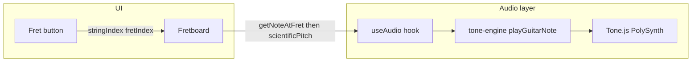

# 阶段三：音频引擎接入与发声机制（详细实施计划）

## 1. 目标与验收标准（与你的文档对齐）

| 来源 | 要求 |
|------|------|
| [Plan.md](e:\CS\My_Projects\Absolute_Fret\Plan.md) 阶段三 | 交付 `useAudio.ts` + `tone-engine.ts`；验收：**点击任意品格触发 Tone.js PolySynth（或 PRD 允许的 PluckSynth 方案）发声**。 |
| [PRD.md](e:\CS\My_Projects\Absolute_Fret\PRD.md) §7 | **每次点击**（对错逻辑在阶段四）在物理位置对应音高上发声；**复音叠加**、不切断上一段自然尾音；**禁止**额外「对错」电子音效；V1 **仅**动态合成、**零**外部音频资源。 |
| [PRD.md](e:\CS\My_Projects\Absolute_Fret\PRD.md) §7 / Plan 补充 | 将播放逻辑封装为 **`playGuitarNote` 纯函数接口**；函数内用**中文注释**预留 V2.0（Howler.js / Web Audio + Audio Sprite）分支占位，**不写死 URL、不引入 mp3**。 |

**本阶段明确不做**：`isTransitioning === true` 时的全局静音与点击拦截（PRD 8.1）；该行为属于 [Plan.md](e:\CS\My_Projects\Absolute_Fret\Plan.md) **阶段四**。阶段三可先实现「凡点击即发声」，与当前无判题逻辑的现状一致。

---

## 2. 现状基线（便于你对照 diff）

- 依赖：[`package.json`](e:\CS\My_Projects\Absolute_Fret\package.json) 已含 `"tone": "^15.1.22"`，无需新增包（除非实现中发现类型/ API 问题再微调）。
- 音高数据：[`src/utils/musicTheory.ts`](e:\CS\My_Projects\Absolute_Fret\src\utils\musicTheory.ts) 的 `getNoteAtFret` 已产出 `scientificPitch`（如 `E2`、`C#3`），**与 Tone.js 音符字符串兼容**，可直接传入合成器，无需再算一遍。
- 点击路径：[`src/components/fretboard/Fretboard.tsx`](e:\CS\My_Projects\Absolute_Fret\src\components\fretboard\Fretboard.tsx) 的 `handleFretClick` 仅更新 `activeSegment`；[`Fret.tsx`](e:\CS\My_Projects\Absolute_Fret\src\components\fretboard\Fret.tsx) 内仍有 `console.log` 调试输出——接入音频时可一并移除，避免噪音与违背「可运行成品感」。

---

## 3. 架构与数据流（阶段三）

- **`tone-engine.ts`**：与 React 无关的**纯模块级能力**——创建/持有合成器实例、`playGuitarNote(科学音高字符串)`、可选的轻量初始化（如 `toDestination()`、合理 `volume`）。对外导出 **`playGuitarNote`**（及若需要的 `ensureAudioStarted` 这类极小 API，见下节）。
- **`useAudio.ts`**：在客户端组件树中**保证 AudioContext 在用户手势后启动**（Tone 15 常用 `Tone.start()` 在首次交互时 `await`），用 `useRef`/`useCallback` 暴露稳定回调给 `Fretboard`，避免无意义重渲染；符合 Plan 中「单例式封装」意图（单例指引擎/合成器一份，而非滥用全局变量破坏可测试性）。

---

## 4. 文件级实施清单

### 4.1 新建 [`src/lib/tone-engine.ts`](e:\CS\My_Projects\Absolute_Fret\src\lib\tone-engine.ts)

- 使用 **PolySynth** 包一层适合拨弦的音色（例如 `PolySynth` + `Synth`/`FMSynth` 等轻量配置，或 PRD 提到的 **`PolySynth(Tone.PluckSynth)`** 若在当前 Tone 15 API 下可用且多声部行为正确）。选型原则：**多声部**、**短 triggerAttackRelease**，尾音自然交叠。
- 实现 **`playGuitarNote(scientificPitch: string): void`**（参数即 `musicTheory` 的 `scientificPitch`）。
- 在 **`playGuitarNote` 内部**用中文注释写清 V2.0 分支：例如「若未来接入 Audio Sprite，在此根据 `scientificPitch` 查表后走 Howler / BufferSource，**当前 V1.0 走合成器分支**」。**禁止** `// TODO`、省略号占位；占位应是**可读的分支说明 + 当前完整可运行分支**。
- 不在此文件引入 React；便于阶段五或单测时直接调用（若你日后加测试）。

### 4.2 新建 [`src/hooks/useAudio.ts`](e:\CS\My_Projects\Absolute_Fret\src\hooks\useAudio.ts)

- 首次用户交互前：`AudioContext` 可能为 `suspended`——在真正播放前执行 **`await Tone.start()`**（或等价 API），避免首次点击无声。
- 返回例如 **`{ playNote: (scientificPitch: string) => void }`**：内部调用 `tone-engine` 的 `playGuitarNote`；若 `Tone.start` 为异步，实现上可用「首次点击时启动 Promise + 队列」或「fire-and-forget 但保证第二次点击前已 started」等**简单可靠**策略，避免过度工程。
- **可选**：`useEffect` 在卸载时 `dispose` 合成器（利于 HMR/严格模式双挂载）；若 Tone 实例挂模块级单例，需处理 React 18 StrictMode 下不重复创建泄漏——以「无泄漏、无双重 toDestination」为准。

### 4.3 修改 [`src/components/fretboard/Fretboard.tsx`](e:\CS\My_Projects\Absolute_Fret\src\components\fretboard\Fretboard.tsx)

- `useAudio()` 取 `playNote`。
- 在 **`handleFretClick`** 中：`const { scientificPitch } = getNoteAtFret(stringIndex, fretIndex)`，然后 **`playNote(scientificPitch)`**，再保留现有 `setActiveSegment` 视觉反馈。
- 保持 **`React.memo` 子组件**契约：`Fret` 仍只接收必要 props；不在 `Fret` 内创建 Tone 实例，避免每格重复初始化。

### 4.4 修改 [`src/components/fretboard/Fret.tsx`](e:\CS\My_Projects\Absolute_Fret\src\components\fretboard\Fret.tsx)（小范围）

- 移除调试用 `console.log`（或改为仅在 `import.meta.env.DEV` 下输出——更干净做法是直接删除，阶段四会用 UI 反馈替代）。

### 4.5 不强制修改但建议你知晓

- [`App.tsx`](e:\CS\My_Projects\Absolute_Fret\src\App.tsx) 中练习页面临时打印 `isTransitioning` 仅为占位；**阶段三不必动**。Plan 文末的 **`DebugPanel`** 属于架构师补充 harness，**不在阶段三里程碑表格内**；若你希望本阶段一并加上，可单独说一声再并入 scope。

---

## 5. 关键行为与边界（防止与 PRD 冲突）

1. **复音**：连续快速点击多格，每次 `triggerAttackRelease`（或等价）使用较短 duration，**不**在每次点击前 `dispose` 整个 synth，**不**对上一 note 做强制 `releaseAll` 除非为降噪确有必要（默认应避免切断尾音）。
2. **音量与刺耳度**：初始 `volume` 或 envelope 调到不炸耳；仍属「极简极客」合成音色即可，不要求拟真吉他。
3. **科学音高仅用于音频**：UI 继续只显示音名等（当前练习页已是 `targetNote` 单字母逻辑）；不在指板上暴露 `scientificPitch`。
4. **禁止**：外部采样文件、Redux、framer-motion、手写非 Tailwind 的额外 CSS 文件（本阶段仅 TS/TSX 与既有 Tailwind 类名）。

---

## 6. 自测清单（你本地可逐项打勾）

1. `npm run dev`，进入练习页，**连续快速点击**不同品格：每次有音，且**尾音可叠**（无明显「一刀切」静音）。
2. 第一次进入页面后**第一次点击**不应无声（用户手势后 Context 已启动）。
3. `npm run build` 无 TypeScript 报错（Tone 类型若需 `//` 类型断言应尽量少用，优先正确泛型/导入）。
4. 控制台无异常红错（尤其 StrictMode 双调用相关）。

---

## 7. 与你「完全理解」的对照摘要

- **阶段三 = 只做「能响 + 架构对」**：引擎文件 + Hook + 指板点击接线 + PRD 要求的 **`playGuitarNote` 与 V2 中文注释分支**。
- **阶段四才接**：题目生成、`isTransitioning` 0.4s 全拦截（含**不发声**）、对错色、Combo/Score 等（见 PRD 8.1、Plan 阶段四）。

若你希望在阶段三**同时**完成 Plan 文末的 **`DebugPanel`（仅 dev 可见）**，与音频无冲突，但属于**扩 scope**；默认本计划**不包含**该项。
